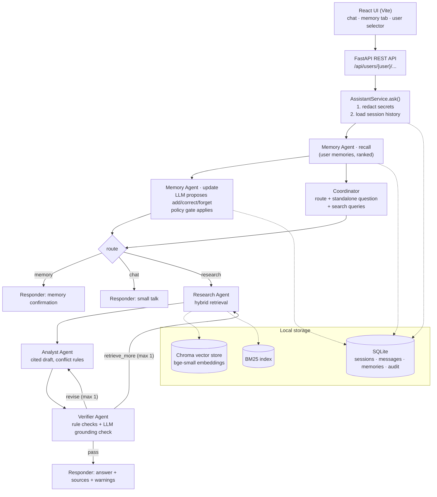

# Design note — Asterline research assistant

## 1. Goal in one paragraph

An employee asks questions about Asterline's documentation and gets answers that are **grounded in the corpus,
cited by chunk ID and title, and honest about conflicts and gaps**. The assistant also **remembers a few useful
things about each user** (role, preferences, ongoing work) across sessions and restarts. Users can see, correct and
delete those memories. Memory personalises answers but is **never** used as evidence for a company fact.

## 2. Architecture

All graph nodes appear as named spans in LangSmith (`assistant_turn` → `recall_memories`, `update_memories`,
`plan`, `research` → `hybrid_search`, `analyse` → `AnalystAgent.draft`, `verify` → `VerifierAgent.check`, ...).
Each answer also carries a plain-text **agent trace** shown in the UI under "Agent trace".

## 3. Agent responsibilities

| Agent | Model | Responsibility | Why separate |
|---|---|---|---|
| **Memory Agent** | gpt-oss-20b (fast) | Recall user memories; decide add / correct / forget from the new message | Memory decisions need a different mindset ("is this about the user and durable?") than answering; a policy gate in code checks every write |
| **Coordinator** | gpt-oss-20b (fast) | Route (research / memory / chat), rewrite follow-ups into standalone questions, plan 1–4 search queries | Follow-ups ("and on Enterprise?") and comparisons need query planning before retrieval |
| **Research Agent** | none (tools) | Execute the plan with hybrid retrieval; run the Verifier's follow-up queries; merge evidence | Deterministic = reproducible and separately measurable (retrieval eval) |
| **Analyst** | gpt-oss-120b | Write the answer from evidence only, with inline `[chunk_id]` citations, conflict/supersession rules, honest gaps | The core reasoning step |
| **Verifier** | gpt-oss-120b | Rule checks (cited IDs must be in evidence; facts need citations) + LLM check that each claim is supported; sends work back | An independent check catches mis-citations and superseded values; it **changes** the result via the revise / retrieve-more loops |

The Memory Agent and Coordinator run **in parallel** (both only need the message, history and recalled memories).
Loops are bounded (≤ 2 Analyst passes, ≤ 2 research rounds), so a turn costs at most 6 LLM calls and normally 4.

## 4. Information flow and the "memory ≠ evidence" rule

1. **Redaction first** (`assistant/redaction.py`): API keys, tokens, `password: …`, long random strings are replaced
   with `[REDACTED_SECRET]` before the message reaches any agent, the LLM provider, SQLite or LangSmith.
2. Prompts separate the two sources explicitly: `USER CONTEXT – personalisation only, NOT evidence` vs `EVIDENCE`.
3. Only corpus chunks can be cited. The Verifier rejects citations that are not in the retrieved evidence, and the
   Responder only lists sources that really were retrieved.
4. The Memory Agent is told not to store company facts stated by the user ("Launch has SSO"), and the Analyst corrects
   such claims with citations (eval scenario M07, case R23).

## 5. Memory design

**What is remembered** (three kinds, short third-person statements):

| Kind | Example | Used for |
|---|---|---|
| `profile` | "Supports Enterprise customers in the EU" | Making questions specific ("my customers' plan") |
| `preference` | "Prefers short bullet-point answers" | Answer style (always included in context) |
| `work_context` | "Investigating duplicate warehouse rows for a customer" | Continuing work in a later session |

**What is not remembered** (enforced by `assistant/memory/policy.py`, not only by the prompt): secrets/credentials,
sensitive personal data (health, medical, finances, …), company facts, previous answers, questions, small talk.

**Lifecycle**
- *Add* — deduplicated; must pass the policy gate.
- *Correct* — the old row becomes `superseded` (kept for the user's audit view, never shown to agents) and a new
  active row points to it. Corrections can come from chat ("Correction: I now support Enterprise") or the Memory tab.
- *Forget* — **hard delete** of the memory and its whole correction chain; the text is also scrubbed from the audit
  log. "Forget everything" deletes all memories for that user. Confirmations do not echo forgotten text.
- *Recall* — preferences always; other memories ranked by embedding similarity, capped at 12.

**Continuity**
- *Within a session*: the last 6 messages are given to the Coordinator (follow-up rewriting) and Analyst.
- *Across sessions / restarts*: only long-term memories carry over. Old transcripts are stored and can be reopened
  from the sidebar, but they are **not** fed into new sessions — so forgetting a memory really removes it from future
  conversations.

**Isolation**: the only way to access data is `Store().for_user(user_id)`; every SQL statement in `UserStore` filters
by that user, sessions are ownership-checked before reads/writes, and the agents receive the already-scoped store via
LangGraph config. There is no API that takes a second user id. Covered by unit tests and eval scenario M05.

## 6. Retrieval

- **Local embeddings**: `BAAI/bge-small-en-v1.5` through fastembed (ONNX, CPU, ~130 MB, no PyTorch).
- **Local vector store**: persistent Chroma (`storage/chroma`), cosine distance. The index stores a fingerprint of the
  corpus + model and rebuilds automatically if either changes. The corpus file is never modified.
- **BM25** over title + text, tokenised to keep `inc-2025-12`, `2.3.1`, `/v2/runs` intact.
- **Reciprocal Rank Fusion** merges the lists (no score calibration needed). Top 8 chunks per round.
- **Sibling expansion**: the other chunks of the 3 best-ranked documents are added, because answers often sit in a
  neighbouring chunk that doesn't repeat the search terms (the cause of INC-2025-12 never mentions the incident ID).
  Up to 18 chunks after two rounds.
- **Second look before abstaining**: if the Analyst says information is missing, the Verifier triggers one more
  search with the standalone question alone before the "not documented" answer is accepted.
  (Both rules came from evaluation failures, see [EVALUATION.md](EVALUATION.md).)
- Evidence is shown to the Analyst ordered by publish date with document version, so time-dependent facts are easy to compare.

## 7. Conflicts and time

The Analyst follows the corpus's own rule (faq:2): compare **topic, effective date, scope and explicit supersession**.
Examples handled: on-call stipend $140 (runbook, 2025) vs $175 (handbook, "supersedes", 2026); cold-storage 60 days
(security overview, 2025) vs 20 days (retention policy, "supersedes"); AQL timeout 25 s (≤ 2.2) vs 50 s (2.3).
When the evidence can't settle it, the answer shows both sides with citations and asks a clarifying question.

## 8. Reliability

- Groq client retries with exponential backoff and honours `Retry-After` on HTTP 429.
- Each call falls back from the main model to the fast one (or vice versa).
- If every model fails: Coordinator defaults to research, Memory Agent skips (no memory change), Analyst returns the top
  passages with citations, clearly labelled as "not a verified answer". The app never crashes on provider errors.

## 9. Trade-offs

| Choice | Benefit | Cost |
|---|---|---|
| Deterministic Research Agent | Reproducible, free, testable alone | No LLM judgement of relevance; relies on Verifier to ask for more |
| Separate Verifier pass | Catches mis-citations / superseded values | +1–3 LLM calls, more latency and tokens |
| Second look before abstaining | Fewer false "not documented" answers | Truly unanswerable questions cost an extra Analyst + Verifier pass |
| Sibling expansion | Recovers answers split across chunks | ~4 more chunks per prompt |
| Two model tiers | Saves the main model's daily token budget | The 20B model is weaker at memory extraction |
| SQLite + per-user scoping | Simple, inspectable, survives restarts | Single-process; not multi-tenant production storage |
| Transcripts not used across sessions | "Forget" is meaningful; small prompts | A user must restate context that wasn't saved as memory |
| Regex secret redaction | Runs before anything else, predictable | Can miss unusual secret formats or redact harmless long IDs |

## 10. Limitations

- Free-tier Groq limits (tokens per day per model) can slow or degrade long evaluation runs.
- Memory extraction is LLM-based; it can miss a memory or save a borderline one (the policy gate only blocks clear cases).
- Forgetting a memory does not rewrite old chat transcripts; users can delete those conversations in the sidebar.
- Evaluation uses keyword checks for answer content; it can't judge phrasing quality and may miss a correct answer
  worded differently. Gold chunk lists were written by hand.
- The demo users are simulated via a selector; there is no real authentication.
- English-only; the 75-chunk corpus is small, so retrieval tuning may not transfer to a large corpus.
